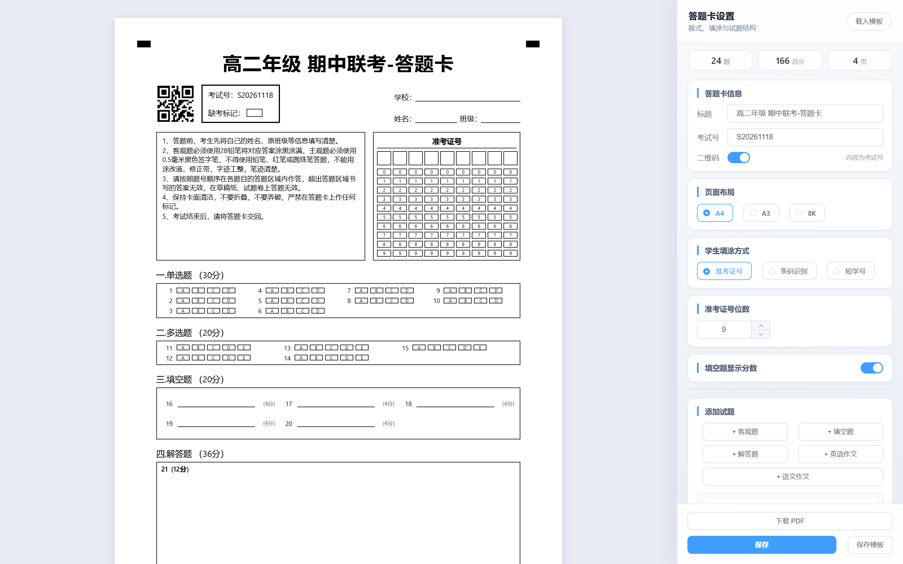
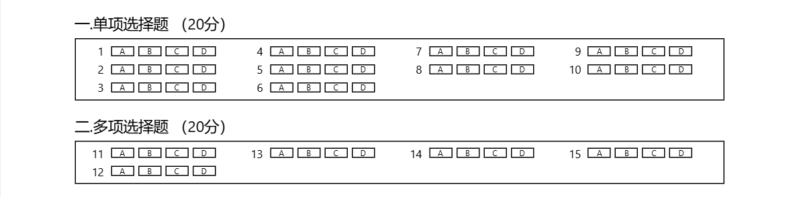
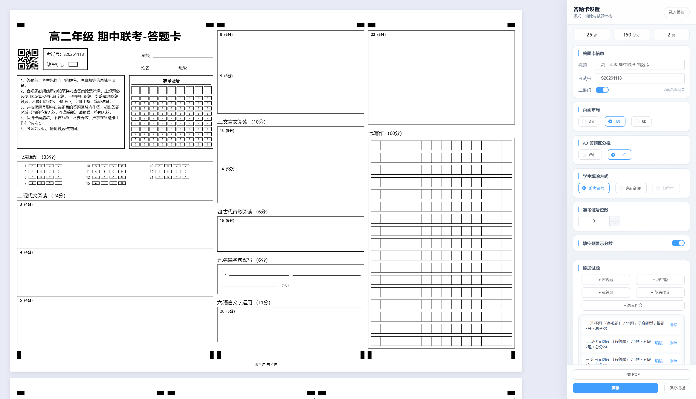
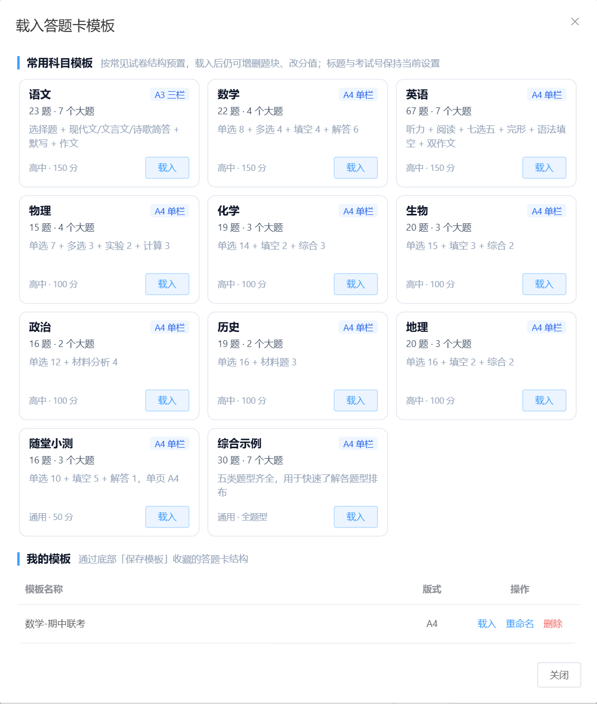
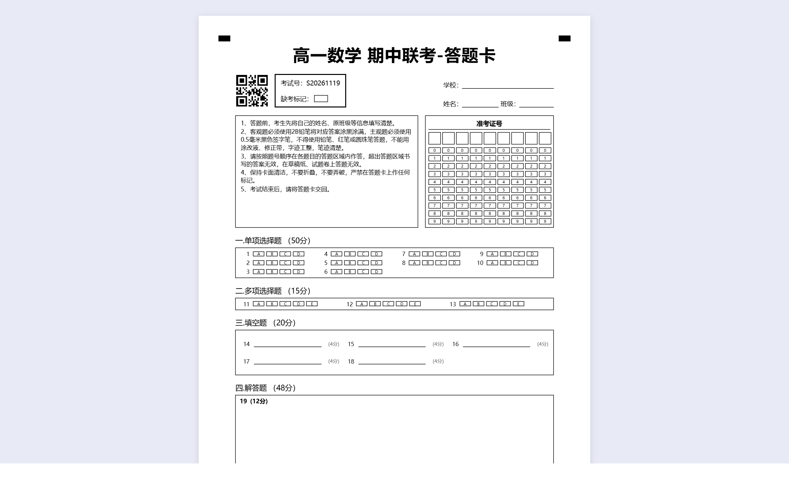
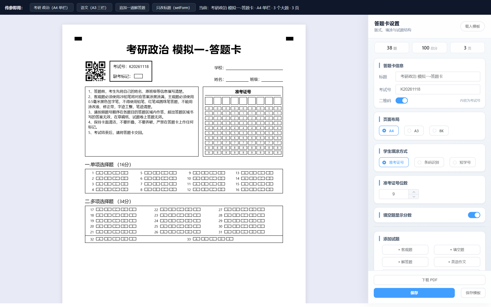

# 答题卡设计器（Answer Sheet Designer）

[](https://github.com/zx454011053/answer-sheet-designer/actions/workflows/ci.yml)
[](LICENSE)

一个可嵌入的 **Vue 2 答题卡设计器插件**：老师在后台可视化排版答题卡，或者由宿主传一段 JSON 直接生成答题卡、打印、导出 PDF。不依赖路由、axios 和后端，只依赖 `vue@2` + `element-ui@2`。

---

## 产品介绍

答题卡是「组卷 → 排版 → 印刷 → 扫描阅卷」链路里最容易被低估的一环：版式差 1mm，填涂框就扫不出来；分页算错，学生就丢作答区。本项目把这部分能力单独做成一个组件，宿主只需要给数据、拿文件。

**它能做什么**

- **可视化排版**：拖动调高作答区、增删题块、改分值、切版式，左侧实时所见即所得。
- **参数直出**：宿主传 `content`（十几行对象）就能得到一张完整答题卡，无需人工排版。
- **真卷面尺寸**：A4 纵向、A3 横向（两栏/三栏）、8K 横向（两栏/三栏）；填涂框 6.1mm × 2.6mm，填涂定位块距纸边约 10.6mm，落在激光打印机不可打印区之外。
- **多页分页**：按页面实测高度逐页推演，页尾自动回填空白（拉高解答题作答区、长填空补行），每页带「第 X 页 共 Y 页」。
- **打印与 PDF**：打印时自动注入当前版式的 `@page`；PDF 默认 200DPI（送印可用 300DPI + PNG），也支持直接拿 `Blob` 上传后端。

**典型场景**

| 场景 | 用法 |
| --- | --- |
| 组卷/阅卷后台给考试配答题卡 | 编辑器内嵌，配 HTTP 数据源，存库、存模板 |
| 题库已定结构，批量出卷 | 传 `content` + `exportPdf()`，不打开编辑器 |
| 题目增删后卡面要跟着变 | `withBlocks()` / `setForm()` 局部更新 |
| 学生查卡、家长确认版式、教务打印定稿 | `readonly` 只读形态 |
| 演示、无后端、临时出卷 | 内置 localStorage 数据源 |

**能力一览**

| 能力 | 说明 |
| --- | --- |
| 版式 | A4 纵向、A3 横向（两栏 / 三栏）、8K 横向（两栏 / 三栏） |
| 题型 | 单选 / 多选 / 判断（客观题横带混排）、填空、解答、英语作文、语文作文 |
| 信息区 | 标题、考试号、二维码、准考证号 / 条码 / 短学号填涂、考生须知 |
| 出图 | 预览所见即所得、浏览器打印（自动注入 `@page`）、PDF 导出（默认 200DPI，A4 四页约 0.8MB） |
| 传参 | `content` 一段普通对象描述整卷；`setContent` / `setQuestionBlocks` / `setForm` 局部更新 |
| 模板 | 内置 11 个科目模板，纯前端常量，点一下即用 |
| 依赖 | 只依赖 `vue@2` + `element-ui@2`（peer / external），无路由、无 axios、无后端耦合 |

## 界面预览



**① 编辑器总览**：左侧所见即所得预览，右侧配置面板实时给出题量 / 总分 / 页数。



**② 客观题横带**：单选 / 多选 / 判断按列自动排布，填涂框按 6.1mm × 2.6mm 输出。



**③ A3 三栏（语文模板）**：一页三个栏位，栏间自动切分，题块不跨栏。



**④ 载入模板**：11 个内置科目模板一键载入，也可把自己的结构存成「我的模板」。



**⑤ 只读模式**：无配置面板与编辑入口，保留打印与导出。



**⑥ 传参出图**：宿主给一段 JSON，组件直接排版，页面上方是宿主自己的切换按钮。

## 环境要求

| 项 | 要求 |
| --- | --- |
| Vue | **2.7+**（源码用了 Composition API，2.6 跑不起来） |
| Element UI | **2.15+**，必须装好并引入主题 CSS（组件内部直接用 `el-button`、`el-dialog` 等，没有自带替代实现） |
| 宿主构建 | 任意（webpack / vite / rollup），或完全不用构建（走 UMD） |
| 打包边界 | `vue`、`element-ui` 已标记 external，由宿主提供；`html2canvas` / `jspdf` / `qrcode` 已打进产物 |
| 浏览器 | Chrome / Edge（Chromium 内核）实测；Safari、Firefox 的 `html2canvas` 与 `@page` 差异较大，未做保证 |

> Vue 2 已 EOL，本组件按 Vue 2.7 的现状维护。

---

## 一、接入方法

组件本身就是一个 Vue 2 插件：`Vue.use()` 装上即用，或者只注册单个组件，或者在无构建的页面里 `mount()`。三种形态任选一种。

### 1.1 拿到产物

```bash
npm install && npm run build            # 1) 本仓库自己构建 → dist/

cd your-app && npm install ../answer-sheet-designer   # 2) 作为本地依赖装进宿主

npm pack                                # 3) 打成 tgz 发给别人（对方 npm i ./answer-sheet-designer-1.0.0.tgz）

cp -r dist/* your-app/public/plugin/    # 4) 直接拷产物到宿主静态目录（chunks/ 要一起拷）
```

走第 2 / 3 种方式时装进去的都是**已构建的 `dist/`**（`files` 白名单只含 `dist`，没有 postinstall 构建），所以要先 `npm run build`；改了源码要重新 build 才会更新。包是 `private: true`，只影响 `npm publish`，不影响 `npm pack` 和本地安装。

| 产物 | 用途 |
| --- | --- |
| `dist/answer-sheet-designer.umd.js` | `<script>` 直接引入，全局变量 `AnswerSheetDesigner`（997KB / gzip 300KB，PDF 依赖已内联） |
| `dist/answer-sheet-designer.es.js` + `dist/chunks/*` | 工程化项目 `import` 使用（chunks 需一起部署）；首屏约 540KB / gzip 140KB，PDF 依赖按需加载 |
| `dist/answer-sheet-designer.css` | 答题卡样式（纸张、填涂区、横带、弹窗），57KB / gzip 8KB |
| `dist/answer-sheet-designer.core.mjs` / `.cjs` | 纯逻辑入口（`answer-sheet-designer/core`），Node / SSR / 测试可用，29KB / gzip 7.7KB |

### 1.2 全局插件：`Vue.use()`（推荐）

```js
// main.js
import Vue from 'vue';
import ElementUI from 'element-ui';
import 'element-ui/lib/theme-chalk/index.css';

import AnswerSheetDesigner from 'answer-sheet-designer';
import 'answer-sheet-designer/dist/answer-sheet-designer.css';

Vue.use(ElementUI);            // 宿主已全量引入 Element UI 时保留即可
Vue.use(AnswerSheetDesigner);  // 注册 <answer-sheet-designer />，并补齐内部用到的 Element 组件
```

装完在任何组件里直接用：

```vue
<answer-sheet-designer
  ref="designer"
  :exam-id="examId"
  :session="{ name: '期中联考', examNo: 'S20261118', paperId: 301 }"
  :data-source="dataSource"
  @back="$router.back()"
  @saved="onSaved"
  @error="onError"
/>
```

- 想换标签名：`Vue.use(AnswerSheetDesigner, { componentName: 'exam-sheet' })`。
- 不想要顶部「返回 + 标题」栏就传 `:show-header="false"`。

### 1.3 只注册组件（不动全局）

适合只在一两个页面用：

```js
import Vue from 'vue';
import { AnswerSheetDesigner, registerElementComponents } from 'answer-sheet-designer';
import 'answer-sheet-designer/dist/answer-sheet-designer.css';

registerElementComponents(Vue);   // 只注册设计器用到的 17 个 Element 组件 + loading 指令（幂等）

export default {
  components: { AnswerSheetDesigner }
};
```

### 1.4 非工程化页面：UMD + `mount()`

老后台、jsp、纯静态页，不接构建：

```html
<!-- 顺序不能颠倒：Vue / ELEMENT 两个全局变量必须先就位 -->
<link rel="stylesheet" href="https://unpkg.com/element-ui/lib/theme-chalk/index.css" />
<script src="https://unpkg.com/vue@2.7.16/dist/vue.js"></script>
<script src="https://unpkg.com/element-ui/lib/index.js"></script>

<link rel="stylesheet" href="/static/plugin/answer-sheet-designer.css" />
<script src="/static/plugin/answer-sheet-designer.umd.js"></script>

<div id="designer" style="height:calc(100vh - 60px)"></div>
<script>
  var handle = AnswerSheetDesigner.mount('#designer', {
    propsData: {
      examId: 9901,
      session: { name: '期中联考', examNo: 'S20261119' },
      dataSource: AnswerSheetDesigner.createLocalDataSource({ storageKey: 'sheet-demo' })
    },
    on: { saved: function (payload) { console.log('saved', payload.id); } }
  });

  // handle.designer 即组件实例：handle.designer.save() / exportPdf() / getDocument()
  // handle.destroy() 卸载组件并移除占位节点
</script>
```

- UMD 走 named exports，全局 `AnswerSheetDesigner` 是命名空间：`mount`、`install`、`createSheetData`、`createLocalDataSource` 等直接挂在上面；组件本体在 `AnswerSheetDesigner.default`。
- `mount()` 挂在容器**内部**的占位节点上，不替换宿主容器，宿主的 id / class / 高度样式都保留。
- 页面里已有 Vue 实例时也可以不 `mount`，改成 `Vue.component('answer-sheet-designer', AnswerSheetDesigner.default)` 后写在模板里。

### 1.5 高度与样式

组件根节点默认高度 **`calc(100vh - 60px)`**（按常见后台 header 预留 60px）。宿主 header 更高、或把组件放进抽屉 / Tab / 弹窗容器时，用外层包一层覆盖：

```css
.sheet-page-wrap { height: calc(100vh - 48px); }   /* 容器必须有确定高度 */
.sheet-page-wrap .answer-sheet-editor { height: 100%; }
```

**窄屏**：右侧面板固定 280px，A4 纸张固定 794px。视口窄于约 1100px（老笔记本、iPad 横屏）时纸张放不下，预览区会自动出现横向滚动条（也可按住空白处拖动平移），不会把纸张裁掉；想在小屏上完整看全页，用 `:show-header="false"` + 隐藏面板腾出宽度。

### 1.6 插件注册了什么

| 类别 | 内容 |
| --- | --- |
| 组件 | `<answer-sheet-designer>`（名字可改） |
| Element 组件 | Button / Checkbox / Dialog / Divider / Form / FormItem / Input / InputNumber / Option / Progress / Radio / RadioGroup / Select / Switch / Table / TableColumn / Tag + `v-loading` 指令，已注册的不会覆盖 |
| 纯函数导出 | `createSheetData` `withBlocks` `validateQuestionNumbering` `normalizeBlockType` `SHEET_LAYOUTS` `SHEET_FILL_TYPES` |
| 模板导出 | `listPresetTemplates` `getPresetTemplate` `createPresetSnapshot` |
| 数据源导出 | `createLocalDataSource` `createHttpDataSource` `normalizeDataSource` |
| 文档/表单导出 | `createEditorDocument` `parseEditorDocument` `createDefaultSheetForm` `computeSheetStats` |
| 其他 | `Message` `MessageBox`（避免宿主再引一次 element-ui 拿这两个）、`install` `mount` `registerElementComponents` |

ES 形态是入口 + 3 个 chunk，**部署时要整个 `dist` 一起拷**。

### 1.7 接上之后自检

| 现象 | 原因 |
| --- | --- |
| 答题卡是白纸 / 没有纸张阴影和填涂框 | 没引 `answer-sheet-designer.css` |
| 按钮、弹窗、下拉都没样式或直接不渲染 | 宿主没注册 Element UI；只注册组件时用 `registerElementComponents(Vue)` |
| 报 `Vue packages version mismatch` / 事件不响应 | 页面里有两份 Vue（CDN 一份 + 打包进来一份），确认 `vue` 走 external |
| 预览区空白但不报错 | `examId` / `session` / `sheet` / `content` 一个都没传，组件拿的是空数据 |
| 保存成功但刷新后没了 | `dataSource` 没传或走的是空实现（纯试排，不落库） |
| 打印只有第 1 页 / PDF 报错 | 宿主没解除 `html/body` 的高度与溢出限制，见 2.7 |

---

## 二、使用方法

接入方式定下（见上章）之后，按业务场景挑一条：

| 方案 | 典型场景 | 数据从哪来 | 关键 API |
| --- | --- | --- | --- |
| [2.1 编辑器内嵌](#21-编辑器内嵌功能最全) | 老师自己排版、存库、另存模板 | 宿主后端（数据源） | 1.2 的 `Vue.use` + `:data-source` |
| [2.2 传参出图](#22-传参出图不打开编辑器) | 组卷 / 题库已定结构，只要答题卡和 PDF | 宿主内存 | `:content` + `exportPdf()` |
| [2.3 联动更新](#23-组卷系统联动只换题不动卡面) | 题目增删后答题卡要跟着变 | 宿主内存 + 局部替换 | `withBlocks` / `setForm` |
| [2.4 离线试排](#24-离线试排--演示页) | 演示、无后端、临时出卷 | localStorage | `createLocalDataSource` |
| [2.5 只读展示](#25-只读展示) | 学生查卡、家长确认版式、打印定稿 | 宿主内存 | `:readonly` + `:content` |

### 2.1 编辑器内嵌（功能最全）

接入代码就是 1.2 那几行，这里只列这个场景额外要做的：

```js
import { createHttpDataSource } from 'answer-sheet-designer';

const dataSource = createHttpDataSource({
  request: ({ url, method, data, params }) => axiosInstance({ url, method, data, params }).then(r => r.data.data),
  paths: { sheet: '/exam/answer-sheets/session/:id', saveSheet: '/exam/answer-sheets' }
});
```

- 传 `:data-source="dataSource"` + `:exam-id`，组件自己加载考试信息、答题卡和模板列表。
- **后台列表切考试不用重新挂载组件**：`:exam-id` 变化会清空当前卷并按新 id 重新加载（`form.id`、题块、标题、考试号一并换掉，避免把结果存回上一场）。如果同时用 `content` 控制内容，则只切换保存目标、不重新拉取。
- `back` 只发事件，路由由宿主自己跳（组件不依赖 vue-router）。
- 宿主已有自己的 Vue / Element UI 版本时，务必走 external，别让页面出现两份 Vue。

### 2.2 传参出图（不打开编辑器）

结构由组卷 / 题库系统算好，只需要答题卡和 PDF 时用这条。传 `content`，组件内部展开成完整答题卡数据，预览区仍可拖拽调高、改标题，但不落库。

```vue
<template>
  <answer-sheet-designer ref="designer" :content="sheet" :show-header="false" />
</template>

<script>
import { createSheetData } from 'answer-sheet-designer';

export default {
  data() {
    return {
      sheet: createSheetData({
        title: '高二数学 期中联考-答题卡',
        examNo: 'S20261118',
        layout: 'A4',
        blocks: [
          { type: 'single',   from: 1,  to: 8,  score: 5 },
          { type: 'multiple', from: 9,  to: 12, score: 5 },
          { type: 'blank',    from: 13, to: 16, score: 5, lines: 1 },
          { type: 'answer',   from: 17, to: 22, score: 12, height: 260 }
        ]
      })
    };
  },
  methods: {
    // 一键导出：走浏览器下载，返回 Promise<boolean>
    async download() {
      await this.$refs.designer.exportPdf();
    }
  }
};
</script>
```

几点注意：

- `show-header=false` 只隐藏顶部「返回 + 标题」栏，右侧配置面板仍在（可以现场微调）。要纯展示，用 CSS 收掉面板：`.answer-sheet-editor .config-panel { display: none }`，并让预览区占满宽度。
- `content` 会按**内容指纹**比对后应用：父组件无关重渲染产生的新对象不会冲掉用户已改的内容，只有内容真的变了才重置。
- 需要「校验题号」时加 `strict: true`，题号断档 / 重号 / 区间重叠会直接抛错，而不是只打 `console.warn`。
- 改完内容后分页依赖 DOM 实测高度，要截图或导出请等渲染稳定：`this.$nextTick()` 之后留一小段延时（demo 里用 400ms）。

### 2.3 组卷系统联动（只换题，不动卡面）

题目增删后直接重传整卷 `content` 会把标题、考试号、版式一起重置回默认值。想保留卡面信息，用 `withBlocks()` 在原卷上换题：

```js
import { withBlocks, validateQuestionNumbering } from 'answer-sheet-designer';

// currentSheet = 宿主上次传给 :content / :sheet 的那份（或 getDocument() 反序列化后的）
const next = withBlocks(currentSheet, [
  { type: 'single', from: 1, to: 10, score: 4 },
  { type: 'answer', from: 11, to: 13, score: 12, height: 300 }
]);

designer.setSheet(next);   // 标题 / 考试号 / 版式 / 填涂方式 / 须知 全部沿用
```

只想改卡面某个字段，不必重建整卷：

```js
designer.setForm({ sheetName: '高一物理 月考-答题卡' });   // 只改标题
designer.setForm({ layout: 'A3', columns: 3 });            // 只改版式与分栏
```

题号校验（吃的是**内部题块**，不是上面的简写）：

```js
const { ok, duplicates, gaps, descents } = validateQuestionNumbering(designer.getQuestionBlocks());
// duplicates: [题号...] / gaps: [[前区间末, 后区间首]...] / descents: 重叠或乱序
```

`setQuestionBlocks(blocks)` 是更底层的入口，替换的是内部题块格式（带 `segments`），一般配合 `getQuestionBlocks()` 的结果做增改，不走简写。

### 2.4 离线试排 / 演示页

不传 `dataSource` = 纯前端试排，不读不写；想留档就用 localStorage：

```js
import { createLocalDataSource } from 'answer-sheet-designer';
const dataSource = createLocalDataSource({ storageKey: 'answer-sheet-designer' });
```

仓库内有两个可运行样例（`npm run build` 后再 `npm run dev`）：`/umd-demo.html`（`mount()` + 数据源）、`/plugin-content-demo.html`（`:content` 传参出图）、`/readonly-demo.html`（只读形态）。

### 2.5 只读展示

学生查答题卡、家长确认版式、教务打印定稿都不需要改数据，开 `readonly` 即可：

```vue
<answer-sheet-designer
  :content="sheetConfig"
  readonly
  :show-header="false"
  :auto-load="false"
/>
```

- 配置面板、题块「编辑 / 删除」、须知「修改」、作答区拖高、拖拽排序全部禁用（CSS 隐藏 + 事件守卫双保险，不会出现「点了没反应」的按钮）。
- 保留预览、滚动、打印和 `exportPdf()` / `getPdfBlob()`。
- 传了 `content` / `sheet` 时**不依赖 `autoLoad`**：`auto-load="false"` 也会立即渲染传入的内容。
- 只需要静态图片时，可以在 `mounted` 后调 `getPdfBlob()` 拿 Blob 自己转 `` 或上传。

### 2.6 使用内置模板

右侧面板「载入模板」→ 弹窗上半部分是 11 个内置科目模板（纯前端常量，不依赖后端、不需要先保存）：

| 模板 | 版式 | 结构 | 题量 / 总分 |
| --- | --- | --- | --- |
| 语文 | A3 三栏 | 选择题 + 现代文/文言文/诗歌简答 + 默写 + 作文 | 23 题 / 150 分 |
| 数学 | A4 | 单选 8 + 多选 4 + 填空 4 + 解答 6 | 22 题 / 150 分 |
| 英语 | A4 | 听力 + 阅读 + 七选五 + 完形 + 语法填空 + 双作文 | 67 题 / 150 分 |
| 物理 | A4 | 单选 7 + 多选 3 + 实验 2 + 计算 3 | 15 题 / 100 分 |
| 化学 | A4 | 单选 14 + 填空 2 + 综合 3 | 19 题 / 100 分 |
| 生物 | A4 | 单选 15 + 填空 3 + 综合 2 | 20 题 / 100 分 |
| 政治 | A4 | 单选 12 + 材料分析 4 | 16 题 / 100 分 |
| 历史 | A4 | 单选 16 + 材料题 3 | 19 题 / 100 分 |
| 地理 | A4 | 单选 16 + 填空 2 + 综合 2 | 20 题 / 100 分 |
| 随堂小测 | A4 | 单选 10 + 填空 5 + 解答 1（单页） | 16 题 / 50 分 |
| 综合示例 | A4 | 单选/多选/判断/填空/解答/英语作文/语文作文 | 30 题 / 150 分 |

- **只替换版式与大题结构**，标题、考试号、填涂方式、学生信息区保持当前设置。
- 标题仍是占位值（`答题卡` 或空）时自动命名为「科目-答题卡」，改过的一律保留。
- 题号从 1 起连续，载入后仍可增删题块、改分值、拖拽调序。
- 要固化成自己的版本：载入 → 调整 → 面板底部「保存模板」，进入弹窗下半部分的「我的模板」（可载入 / 重命名 / 删除）。

模板数据可脱离 UI 复用（例如题库导入时预生成答题卡）：

```js
import { listPresetTemplates, getPresetTemplate, createPresetSnapshot } from 'answer-sheet-designer';

listPresetTemplates();                 // 11 个模板（含题块、总分、题量、版式标签）
createPresetSnapshot('preset-math');   // 深拷贝快照，可直接交给设计器 / 落库
```

### 2.7 打印与 PDF

**浏览器打印（Ctrl+P）**

1. 缩放必须选「实际大小」/ 100%，不要选「适合页面」——后者会等比缩小约 7%，填涂框位置和作答区高度全部偏移。
2. 纸张与版式一致：A4 纵向 210×297mm、A3 横向 420×297mm、8K 横向 390×270mm。
3. 组件已按当前版式注入 `@page { size: …; margin: 0 }`，无需手设页边距。
4. **宿主必须解除 `html/body/#app` 的高度与溢出限制**，否则只打印第 1 页：

```css
@media print {
  html, body, #app { height: auto !important; overflow: visible !important; }
  .your-app-shell, .your-main { height: auto !important; overflow: visible !important; display: block !important; }
}
```

**PDF 导出**

- 默认 200DPI / JPEG（A4 四页约 0.8MB），屏幕校对与普通打印够用。
- 送印刷厂建议 `:pdf-dpi="300" :pdf-image-format="'PNG'"`：0.26mm 细边框更实，不会被 JPEG 压缩发虚。
- 导出是整页位图，不是矢量 PDF。需要矢量文字时改用浏览器打印 →「另存为 PDF」。
- **要文件不要下载**：`await designer.getPdfBlob()` 返回 `Blob`（`application/pdf`），可直接 `FormData` 上传后端或 `URL.createObjectURL` 预览；批量生成时循环调用即可，不弹进度框、不触发下载。
- html2canvas / jsPDF 是**按需加载**的：ES 入口首屏不下载，首次点导出时才拉约 800KB 的依赖 chunk。UMD 单文件无法拆分，体积仍是全量。

**多实例同页**：`@page` 是全局规则，浏览器里同时只有一条生效。组件用「实例注册表 + 最近操作者优先」处理：同页挂两个不同版式的设计器时，谁最后被点 / 改过版式，打印就用谁的纸张尺寸；卸载其中一个不会删掉另一个需要的规则。

**版式自检**：打印首张样张后量任一填涂框，应为约 **6.1mm × 2.6mm**，偏差超过 0.2mm 说明打印缩放没设对。

---

## 三、参数说明

### 3.1 Props

| 名称 | 类型 | 默认 | 说明 |
| --- | --- | --- | --- |
| `examId` | String/Number | `null` | 考试 id，交给数据源加载/保存。**运行中变化会重新加载**（后台切考试不必重新挂载组件）；传了 `sheet` / `content` 时只切换保存目标，不重新拉取 |
| `session` | Object | `null` | 考试信息 `{ name, examNo, paperId }`；传入后不再调 `loadSession` |
| `sheet` | Object | `null` | 直接给答题卡数据（含 `editorJson`），优先级高于 `loadSheet` |
| `content` | Object | `null` | 简写内容配置，内部展开成 `sheet`；与 `sheet` 同时传时以 `sheet` 为准 |
| `dataSource` | Object | `null` | 数据源；不传则为空实现（纯试排，不落库） |
| `showHeader` | Boolean | `true` | 预览区顶部「返回 + 标题」栏 |
| `autoLoad` | Boolean | `true` | 挂载后自动加载 |
| `pdfDpi` | Number | `200` | 导出 PDF 的栅格化精度 |
| `pdfImageFormat` | String | `'JPEG'` | `JPEG`（体积小）/ `PNG`（线稿更锐利） |
| `pdfImageQuality` | Number | `0.92` | JPEG 质量 |
| `readonly` | Boolean | `false` | 只读：隐藏配置面板与全部编辑入口，保留打印与导出 |
| `debug` | Boolean | `false` | 输出分页/度量调试日志；也可用 `localStorage.setItem('answer-sheet-designer:debug', '1')` 临时打开。默认不向宿主控制台输出任何内容 |

### 3.2 Events

| 事件 | 载荷 | 时机 |
| --- | --- | --- |
| `back` | — | 点击返回 |
| `saved` | 保存报文（含 `id`） | 保存成功 |
| `template-saved` | 模板报文（含 `id`） | 另存为模板成功 |
| `error` | `Error` | 加载/保存/解析异常 |

### 3.3 实例方法（`ref` 或 `mount()` 返回的 `designer`）

| 方法 | 说明 |
| --- | --- |
| `save()` / `saveAsTemplate(name?)` | 保存答题卡 / 另存为模板（走 `dataSource`） |
| `exportPdf()` | 导出 PDF，返回 `Promise<boolean>`，走浏览器下载 |
| `exportPdf({ download: false })` | 返回 `Promise<Blob>`，不触发下载、不弹进度框；批量生成用 |
| `getPdfBlob()` | 等价于 `exportPdf({ download: false, silent: true })` |
| `load()` / `reload()` | 按 `examId` 重新加载 |
| `getDocument()` | 返回可持久化的 `editorJson` 字符串 |
| `getForm()` / `getQuestionBlocks()` | 取当前表单 / 题块 |
| `getPreviewPages()` | 取分页结果（含分栏切片、页尾回填后的高度），与实际预览一致 |
| `getStats()` | 实时统计 `{ totalScore, questionCount, choiceCount, subjectiveCount, ... }` |
| `setSheet(sheet)` | 整份替换内容（不落库） |
| `setContent(config)` | 用 `content` 简写整份替换（也接受保存报文，见 3.5） |
| `setQuestionBlocks(blocks)` | 只换题块（内部格式，带 `segments`），保留标题/考试号/版式 |
| `setForm(patch)` | 局部改表单字段（标题、考试号、版式、分栏、须知…） |

### 3.4 传参规范：`content`

`content` 是「整卷结构」的简写，`createSheetData()` 会把它展开成设计器内部使用的 `sheet`（含 `editorJson`）。也可以先构造再传 `:sheet`，两者同时存在时以 `sheet` 为准。

顶层字段：

| 字段 | 默认 | 说明 |
| --- | --- | --- |
| `title` | `'答题卡'` | 答题卡标题（同时是 PDF 文件名） |
| `examNo` | `''` | 考试号，同时作为二维码内容 |
| `layout` | `'A4'` | `A4` / `A3` / `8K` |
| `columns` | `2` | A3、8K 的分栏数（`2` / `3`），A4 忽略 |
| `fillType` | `'admission'` | `admission` 准考证号 / `barcode` 条码 / `short-number` 短学号 |
| `qrcode` | `true` | 是否显示二维码 |
| `notice` | `[]` | 考生须知，字符串或字符串数组（数组按行拆分） |
| `blocks` | `[]` | 题块列表，见下表 |
| `editorJson` | — | 已序列化的答题卡文档（字符串或对象）；**没传 `blocks` 时**按原样还原题块 |
| `form` | `{}` | 其余表单字段原样透传（`verticalLayout`、`fillBlankMode`、`admissionColumns` 等） |
| `strict` | `false` | 题号不连续时抛错；默认只 `console.warn` |

题块（`blocks[]`）：

| `type` 简写 | 生成 | 可用字段 |
| --- | --- | --- |
| `single` / `multiple` / `judge` | 客观题横带 | `from`、`to`、`score`、`options`（选项数）、`title`、`items`（分段，每段可不同分值/选项数） |
| `blank` | 填空题 | `from`、`to`、`score`、`lines`（每题横线数）、`long`（整段长横线） |
| `answer` | 解答题 | `from`、`to`、`score`、`height`（作答区高度 px，默认 180） |
| `english` | 英语作文 | `no`、`score`、`lines`、`opening` |
| `chinese` | 语文作文 | `no`、`score`、`words` / `maxWords` |

- 别名：`radio`→single、`multi`→multiple、`fillblank`→blank、`subjective`→answer、`composition`→chinese。
- `from`/`to` 也可写 `startNum`/`endNum`、`num`/`no` 或 `range: [1, 10]`。
- 一个题块内可混分段：`{ type: 'single', items: [{ from: 1, to: 2, score: 3 }, { from: 6, to: 6, score: 4 }] }`。
- 也可以直接传设计器内部题块（带 `segments`），构造器只补 `id` 与大题号。
- 反过来，把后端存的那条记录（含 `editorJson`）直接传进来也能还原，不必改写成简写——见 3.5。

### 3.5 保存报文与 `editorJson`

点「保存」写进宿主的只有两部分：**一组扁平字段 + 一个 `editorJson` 字符串**。表结构由宿主定，组件只保证这两部分的内容。

```json
{
  "id": null,
  "examSessionId": 301,
  "paperId": 9001,
  "sheetName": "高二数学 期中联考-答题卡",
  "layoutType": "A4",
  "a3ColumnCount": 2,
  "fillType": "admission",
  "pageCount": 2,
  "questionCount": 7,
  "choiceCount": 2,
  "subjectiveCount": 3,
  "verticalLayout": false,
  "fillBlankMode": "box",
  "fillBlankShowScore": true,
  "questionCardMerge": false,
  "absentMarkEnabled": 1,
  "barcodeEnabled": 0,
  "qrcodeEnabled": 1,
  "admissionCardEnabled": 1,
  "studentInfoEnabled": 1,
  "admissionColumns": 9,
  "noticeText": "",
  "editorJson": "{\"version\":1,\"questionBlocks\":[…]}"
}
```

| 字段 | 说明 |
| --- | --- |
| `id` | 答题卡主键，新建时为 `null`；保存成功后组件用返回的 `id` 回填 |
| `examSessionId` / `paperId` | 考试 id（= 传进来的 `examId`）/ 试卷 id（来自 `session`） |
| `sheetName` | 答题卡标题，也是 PDF 文件名 |
| `layoutType` / `a3ColumnCount` | `A4` / `A3` / `8K`；A3、8K 分栏数 `2` / `3` |
| `fillType` | `admission` 准考证号 / `barcode` 条码 / `short-number` 短学号 |
| `pageCount` | 预览页数（前端分页结果，不是后端算的） |
| `questionCount` / `choiceCount` / `subjectiveCount` | 题量统计，与配置面板同口径（`computeSheetStats`） |
| `verticalLayout` / `fillBlankMode` / `fillBlankShowScore` / `questionCardMerge` | 客观题竖排、填空样式（`box` / `line`）、填空是否标分值、题目卡合并 |
| `absentMarkEnabled` / `barcodeEnabled` / `qrcodeEnabled` / `admissionCardEnabled` / `studentInfoEnabled` | 卷头各功能区块开关，`1` / `0` |
| `admissionColumns` / `noticeText` | 准考证号填涂列数（默认 `9`）/ 考生须知（多行用 `\n`） |
| `editorJson` | 题块与编辑态，见下 |

两个容易踩的点：

- **`examNo` 不在报文顶层**。考试号只随 `editorJson` 存取（`buildSheetPayload` 会主动剔除顶层 `examNo`），宿主后端不需要为此加字段。
- **所有开关遵循 `1` / `0`**，不是 `true` / `false`（`verticalLayout`、`fillBlankShowScore`、`questionCardMerge` 这几个是布尔，保持原样）。

`editorJson` 是一个 JSON **字符串**（`version: 1`），由 `createEditorDocument()` 生成：

```json
{
  "version": 1,
  "questionBlocks": [
    {
      "id": 1, "type": "objective", "sectionNo": 1, "sectionTitle": "单项选择题",
      "segments": [
        { "tempId": "mwm1ofhh-1-5f8piq", "objectiveType": "single", "startNum": 1, "endNum": 2, "scorePerQuestion": 5, "optionCount": 4 }
      ]
    },
    {
      "id": 2, "type": "fillblank", "sectionNo": 2, "sectionTitle": "填空题",
      "segments": [
        { "tempId": "mwm1ofhh-2-n4anpo", "fillBlankType": "short", "startNum": 3, "endNum": 4, "scorePerQuestion": 4, "lineCount": 1 }
      ]
    },
    {
      "id": 4, "type": "chinese", "sectionNo": 4, "sectionTitle": "语文作文",
      "questionNo": 7, "scorePerQuestion": 60, "minWordCount": 800, "maxWordCount": 1000
    }
  ],
  "nextQuestionBlockId": 5,
  "fillType": "admission",
  "verticalLayout": false,
  "fillBlankMode": "box",
  "fillBlankShowScore": true,
  "questionCardMerge": false,
  "examNo": "S20261118",
  "qrcodeEnabled": 1
}
```

题块公共字段 `id`（前端自增）、`type`、`sectionNo`（大题号，决定顺序）、`sectionTitle`（大题标题）。各类型差异：

| `type` | 字段 |
| --- | --- |
| `objective`（单选/多选/判断合称） | `segments[]`：`objectiveType`（`single` / `multiple` / `judge`）、`startNum`、`endNum`、`scorePerQuestion`、`optionCount` |
| `fillblank` | `segments[]`：`fillBlankType`（`short` / `long`）、`startNum`、`endNum`、`scorePerQuestion`、`lineCount` |
| `answer` | `segments[]`：`startNum`、`endNum`、`scorePerQuestion`、`areaHeight`（作答区高度 px） |
| `english` | `questionNo`、`scorePerQuestion`、`lineCount`、`openingText`、`showSectionTitle` |
| `chinese` | `questionNo`、`scorePerQuestion`、`minWordCount`、`maxWordCount` |

- `segments[].tempId` 是前端生成的稳定 key，只用于渲染 diff，落库保留即可、不参与业务。
- 题号信息全在 `segments` 的 `startNum` / `endNum` 里（`english` / `chinese` 用单个 `questionNo`），所以宿主想统计或校验题号，直接遍历 `segments` 就行。
- `editorJson` 只是字符串，后端不要试图解析或改写它，组件升级时结构可能扩展。回读不校验 `version`，只按字段有无做兼容（新增字段一律「有则用、无则取默认」）。

**读回来：`loadSheet` 要返回什么**

返回结构与保存报文完全一致即可（同一个对象存进去、原样取出来最省事）。三个硬要求：

1. **字段名用 `layoutType`，不是 `layout`**。`layout` 只是 `createSheetData()` 的入参别名；回读时未被识别的键会被直接忽略，`layoutType` 保持默认 `A4`，看起来像「版式没存住」。
2. **`editorJson` 必须是字符串**。`parseEditorDocument()` 只接受字符串，若后端用 `jsonb` / `json` 列返回了对象，组件会视为无题块——在数据源里 `JSON.stringify` 一下即可。
3. 缺字段不会报错：`applySheetData()` 逐个覆盖，没给的字段保持默认值。所以最小可用返回是 `{ layoutType, editorJson }`。

```js
// 数据源里兜一下 jsonb 的情况
async loadSheet({ examId }) {
  const data = await request({ url: `/exam/answer-sheets/session/${examId}`, method: 'get' });
  if (data && data.editorJson && typeof data.editorJson !== 'string') {
    data.editorJson = JSON.stringify(data.editorJson);
  }
  return data;
}
```

**传参与保存报文的对应关系**：两套参数不需要逐字对应，`content` 是「人写的简写」，报文是「完整扁平结构」。

| `content` 简写（传入） | 保存报文（落库） | 说明 |
| --- | --- | --- |
| `title` | `sheetName` | 只是叫法不同 |
| `examNo` | 只在 `editorJson.examNo` 里 | 顶层没有该字段，宿主不用加列 |
| `layout` | `layoutType` | `layoutType` 也接受；回读只认它 |
| `columns` | `a3ColumnCount` | A4 下忽略 |
| `fillType` | `fillType` + `editorJson.fillType` | 双写，保证单独读 `editorJson` 也能还原 |
| `qrcode`（布尔） | `qrcodeEnabled`（`1`/`0`）+ `editorJson` | 布尔 → 数字 |
| `notice`（字符串 / 数组） | `noticeText`（多行 `\n` 连接） | 数组按行合并 |
| `blocks`（简写题块） | `editorJson.questionBlocks`（内部题块） | 结构不同 |
| `form.verticalLayout` / `form.fillBlankMode` … | 同名字段 | 通过 `form` 透传 |

往返是通的：后端 `loadSheet` 返回的那条记录、或保存报文本身，既能当 `:sheet` / `setSheet()`，也能当 `:content` / `setContent()`——`createSheetData()` 发现没有 `blocks` 但带了 `editorJson`（字符串或已解析对象都行），就把里面的题块原样取出来，不再按简写展开。`createSheetData()` 的产物本身就是保存报文的形状，所以「传参 → 保存 → 回读 → 再传参」全程同一套字段，不需要写转换层。`blocks` 与 `editorJson` 同时给时以 `blocks` 为准。

### 3.6 数据源接口

设计器只认下面 8 个**可选**方法，缺哪个就降级为安全空实现：

```js
{
  loadSession({ examId })        → { name, examNo, paperId } | null
  loadSheet({ examId })          → 答题卡数据（字段同保存报文，见 3.5）| null
  saveSheet({ examId, payload }) → { id } | null
  listTemplates()                → [{ id, templateName, layoutType }]
  getTemplate({ id })            → 模板数据 | null
  saveTemplate({ payload })      → { id } | null
  renameTemplate({ id, templateName }) → { id } | null
  deleteTemplate({ id })         → { ok: true } | null
}
```

`renameTemplate` / `deleteTemplate` 是可选的：不实现时模板弹窗里的「重命名 / 删除」会提示失败，其他功能不受影响（`normalizeDataSource` 会把缺失方法补成返回 `null`）。

> **`saveSheet` 必须把主键返回**（`{ id }`）。组件靠它回填 `form.id`，下次保存才走「更新」；返回 `null` 时界面仍提示「保存成功」，但下一次保存还是新建——一条答题卡会存成多条。若后端把 id 放在别的字段，在数据源里映射一下：`.then(r => ({ id: r.data.sheetId }))`。

已内置两种：

```js
// 1) 浏览器本地存储（demo / 离线试排）
const ds = createLocalDataSource({ storageKey: 'answer-sheet-designer' });

// 2) HTTP：默认路径可按既有后端接口整体覆盖
const ds = createHttpDataSource({
  request: ({ url, method, data, params }) => axiosInstance({ url, method, data, params }).then(r => r.data.data),
  paths: { sheet: '/exam/answer-sheets/session/:id', saveSheet: '/exam/answer-sheets' }
});
```

`request` 传既有 axios 实例的「解包后」函数即可，组件无需改动。本地数据源把数据写在 `localStorage[storageKey]` 里，结构是 `{ sheets: { [examId]: payload }, templates: [payload…] }`——想确认报文长什么样，直接打开 DevTools 看这个键。

另存为模板时的报文（`saveTemplate` 的 `payload`）不带 `id` / `examSessionId` / `paperId` / `sheetName` / `fillType`，其余与 3.5 同源，多一个 `templateName`。载入模板时组件只取版式、题块和各开关，**保留当前答题卡的 `id` / `examSessionId` / `paperId` / 标题 / 考试号**。

### 3.7 纯逻辑入口：`answer-sheet-designer/core`

主入口会加载 Vue 组件与 element-ui，而 **element-ui 2.x 在模块顶层就访问 `document`**，所以 Node 里 `require('answer-sheet-designer')` 会直接抛 `ReferenceError: document is not defined`。只想构造数据、校验题号、读写 `editorJson` 时，用纯逻辑子入口：

```js
// ESM
import { createSheetData, parseEditorDocument, buildSheetPayload } from 'answer-sheet-designer/core';
// CommonJS
const { createSheetData } = require('answer-sheet-designer/core');

const sheet = createSheetData({ title: '高二数学', blocks: [{ type: 'single', from: 1, to: 8 }] });
const { questionBlocks } = parseEditorDocument(sheet.editorJson);
const payload = buildSheetPayload(createDefaultSheetForm(sheet), questionBlocks);
```

导出成员：`createSheetData` / `withBlocks` / `validateQuestionNumbering` / `normalizeBlockType` / `SHEET_LAYOUTS` / `SHEET_FILL_TYPES` / `createEditorDocument` / `parseEditorDocument` / `buildSheetPayload` / `createDefaultSheetForm` / `DEFAULT_NOTICE` / `listPresetTemplates` / `getPresetTemplate` / `createPresetSnapshot` / `computeSheetStats` / `getDefaultSectionTitle` / `getQuestionTypeLabel`。

这个入口零 DOM 依赖（29KB / gzip 7.7KB），后端（Node BFF、脚本、CI）可以直接生成与校验答题卡数据。

**SSR**：`<answer-sheet-designer>` 本身要 DOM（尺寸测量、canvas 二维码、`@page` 注入）。Nuxt 里用 `<client-only>` 包一层，或只在浏览器端动态引入；服务端只需要数据时走 `core`。

### 3.8 卡面信息：标题 / 考试号 / 二维码

右侧面板顶部「答题卡信息」：标题写 `form.sheetName`（PDF 文件名也用它）、考试号写 `form.examNo`（同时是二维码内容）、二维码开关写 `form.qrcodeEnabled`。

- 这几个字段都落进 `editorJson`，`buildSheetPayload` 会把 `examNo` 从顶层报文里剔除，宿主后端沿用原有保存接口即可。
- `form.examNo` 为空时回落 `session.examNo`，再没有就按 `examId` 生成 `S12345678` 形态兜底。
- 标题按顶区实测宽度自适应字号（16~34px，单行），长标题不会换行挤掉首屏题位。
- 存量数据没有 `qrcodeEnabled` 视为「未配置」，默认显示二维码；用户主动关闭后写入 `0` 并生效。

---

## 本地开发

```bash
npm install
npm run dev        # http://localhost:5273/ 编辑器 demo（另有 /umd-demo.html、/plugin-content-demo.html、/readonly-demo.html）
npm run build      # 产出 dist/，并同步副本到 public/preview/
npm run test:core  # core 纯逻辑自检（38 项，不依赖浏览器）
```

浏览器回归脚本需要本机 Chromium（优先 `CHROME_PATH`，其次 playwright 缓存，最后系统 Chrome/Edge）：

```bash
npx playwright install chromium
npm run verify:e2e        # 还有 verify:layouts / print / presets / release / narrow … 见 package.json
npm run capture:docs      # 重新生成 docs/images 里的 README 截图
```

`dist/` 与 `public/preview/` 是构建产物，不入库；提交前跑一次 `npm run build && npm run test:core`。

## 注意事项

- 题块 id 是前端自增，多端同时编辑需要宿主下发版本号做冲突控制。
- 题号校验只在保存时提示（断档 / 重号会弹确认框，可选「仍然保存」，因为 AB 卷可能真的跳号），编辑过程中不实时报警。
- 纸张容器带 `overflow: hidden`，分页算错时多出的内容会被静默裁切，不报错。
- 页尾空隙回收只覆盖解答题（加大作答区）与长填空（补行），以作文格结尾的页仍会留白。
- 不接 OMR 识别与扫描裁切，本项目只负责版式设计与导出。

## License

MIT
